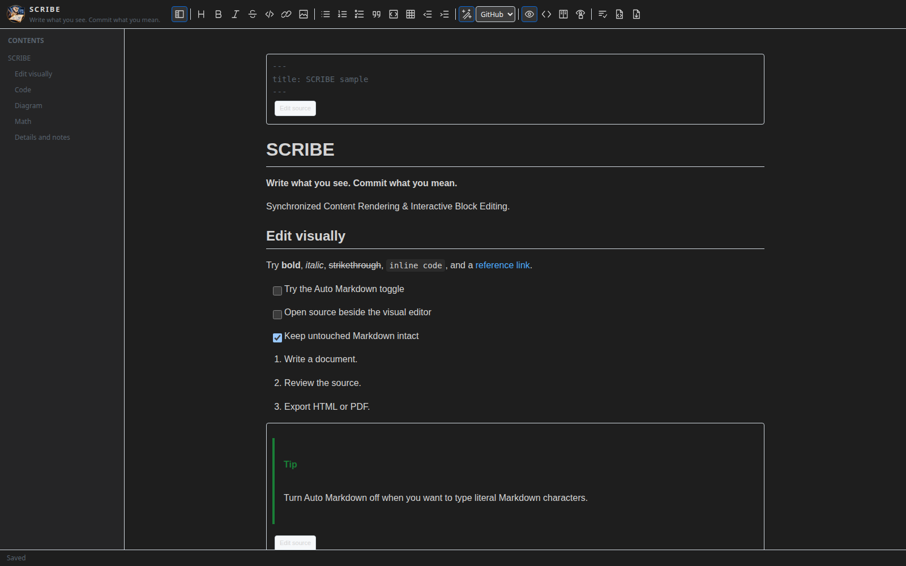
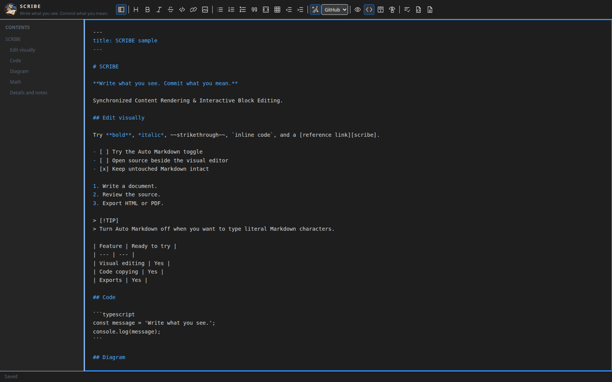
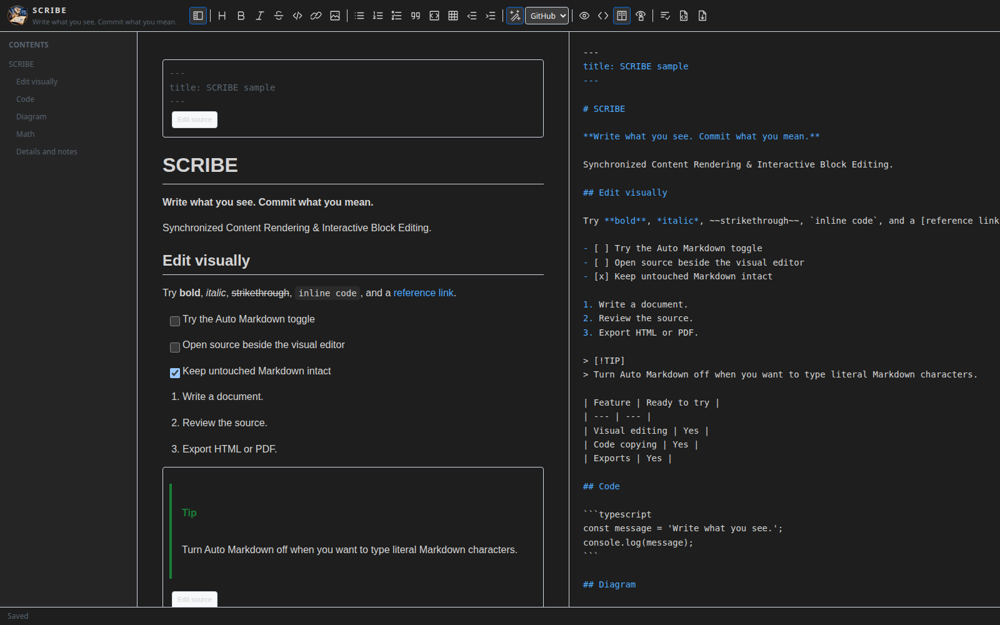
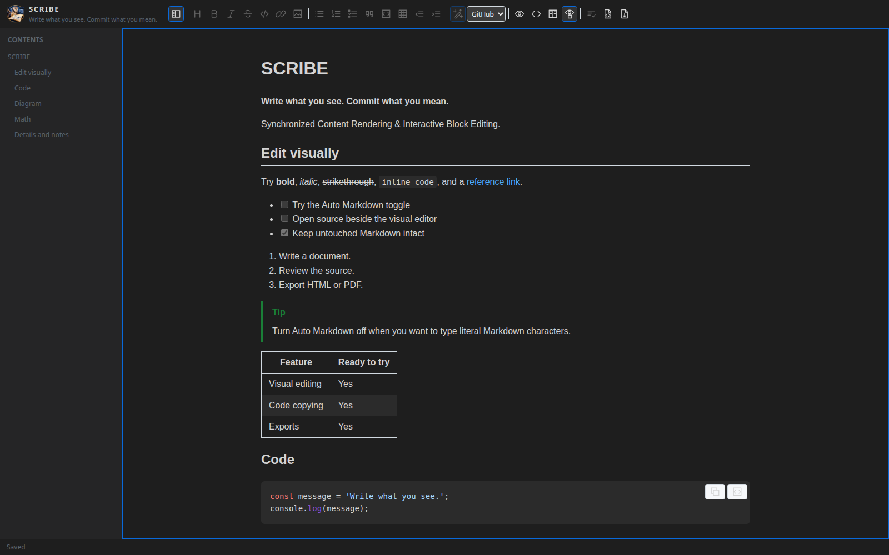

<p align="center"></p>

# SCRIBE - WYSIWYG Markdown Editor

**Write what you see. Commit what you mean.**

SCRIBE stands for **Synchronized Content Rendering & Interactive Block Editing**. It brings visual Markdown editing, native source views, code copying, and HTML/PDF export into one VS Code extension.

<!-- screenshots:start -->
## Editor views

Captured from [`test/fixtures/sample.md`](test/fixtures/sample.md), with the table of contents visible.

**WYSIWYG view**



**Source view**



**Split view**



**Read-only preview**


<!-- screenshots:end -->

## Development status

SCRIBE is an early release. TypeScript checking and all 29 core/regression tests pass. Use the committed `package-lock.json` with `npm ci` for reproducible installs.

Browser editing, native VS Code integration, PDF output, and cross-platform/Remote smoke tests remain release gates. The automated browser/native tests are blocked in the implementation environment by local-server and Electron restrictions. First-use fixes have regression coverage, including heading preservation, code-block exits, source formatting, HTML progress completion, and isolated PDF callback execution. Packaging alone does not validate complete editor behavior or PDF output.

## Open a document

Run **SCRIBE: Open in SCRIBE**, or choose **Reopen Editor With → SCRIBE** on a `.md` or `.markdown` file. SCRIBE is optional; it does not replace your default Markdown editor.

Use **Source view**, **WYSIWYG view**, **Split view**, or **Read-only preview** in the toolbar. All four stay inside the same SCRIBE tab. Split displays editable Markdown beside the visual editor, with synchronized selection and scrolling. Both editing panes share the same file, save state, undo history, and toolbar. Formatting actions apply to the focused pane: Markdown syntax in Source, rich formatting in WYSIWYG.

**Read-only preview** shows the rendered document without typing or source-edit controls, similar to a repository Markdown page. Formatting buttons, editing menus, Normalize, and SCRIBE undo/redo are disabled. All view-switch buttons stay active, along with rendering-profile selection, code copying, and HTML/PDF export. Pending edits reach the document before entering preview; switching views does not discard them.

**Table of contents** lists headings on the left and jumps to them in every view. It opens automatically when the editor is at least 1,100 pixels wide and hides on narrower editors. Use the toolbar toggle to override this; your choice persists for that editor across view changes and reloads. The list updates as you edit and ignores headings inside code blocks.

The status bar shows **Unsaved changes** until the VS Code document is saved, then **Saved**. Use Ctrl/Cmd+S to save.

## Write visually, or type Markdown

The compact toolbar shares a row with the SCRIBE branding when there is room and wraps underneath in narrower windows. Its icons have tooltips and accessible labels. Use its heading menu, formatting buttons, and **Table actions** menu to insert tables or add/remove rows and columns. Controls follow the VS Code light, dark, and high-contrast themes.

Source and Split views highlight Markdown syntax as you type. The source remains plain editable Markdown, with colors following the editor theme.

With **Auto Markdown: On**:

- Type `# `, `- `, `1. `, or `> ` to start a heading, list, or quote.
- Close delimiters such as `**bold**`, `*italic*`, or `` `code` `` to format inline text.
- Press Enter to render valid Markdown in the current plain-text block and continue writing.
- Type an opening code fence such as three backticks followed by `js`, then press Enter to start a code block. Newlines inside code remain literal.
- Use Shift+Enter for a soft break. A table header and separator can be entered with Shift+Enter and committed with Enter.

Turn **Auto Markdown: Off** in the toolbar to type Markdown characters literally. This disables automatic space, delimiter, and Enter conversions. Existing formatting and explicit toolbar actions still work; Enter continues existing lists normally. The toggle never rewrites the document. It persists through `scribe.autoFormatMarkdown` and updates open SCRIBE editors. Toolbar preferences use an existing workspace override when present; otherwise they save to user settings.

Use Ctrl/Cmd+Z for undo, Ctrl/Cmd+Shift+Z or Ctrl/Cmd+Y for redo. Conversion, normalization, and source edits participate in VS Code's document history.

| Shortcut | Action in either pane |
| --- | --- |
| Ctrl/Cmd+B | Toggle bold |
| Ctrl/Cmd+I | Toggle italic |
| Ctrl/Cmd+E | Toggle inline code |
| Ctrl/Cmd+Shift+X | Toggle strikethrough |
| Ctrl/Cmd+K | Insert/edit a link |
| Ctrl/Cmd+S | Save |

In a visual code block, Ctrl/Cmd+Enter moves to a paragraph after it. Down Arrow at the end also exits to an available blank paragraph. You can click the line below the block or use its **Continue after code block** button. Regular Enter keeps writing code. In Source, Tab/Shift+Tab indent/outdent, and Escape focuses the toolbar.

## Keep meaningful Git diffs

Opening a file does not rewrite it. Visual edits retain the exact source of semantically unchanged blocks, including their original markers and intervening whitespace. Only changed regions are serialized. Source line endings are retained.

**Normalize** explicitly formats the whole document with ATX headings, dash bullets, fenced code, consistent spacing, and no prose wrapping. It is one undoable document edit. Front matter and raw HTML are preserved.

Front matter, reference definitions, comments, HTML, alerts, footnotes, and math retain their source. Specialized content exposes **Edit source** or **Edit**, with **Apply** and **Cancel**. Ctrl/Cmd+Enter applies a block source edit; Escape cancels. HTML-containing blocks use this source-backed view to preserve their complete markup.

If source changes race pending visual edits, SCRIBE refreshes to the current source and preserves the pending visual content in an untitled Markdown document for recovery.

## Rendering support

Select **GitHub** or **GitLab** in the toolbar. Both profiles follow the VS Code theme in the editor; exports use a light document theme. These are local rendering profiles, not pixel-exact replicas of either website.

| Content | Visual editor | HTML/PDF |
| --- | --- | --- |
| CommonMark headings, paragraphs, emphasis, quotes, links, images, lists | Editable | Rendered |
| GFM tables, task lists, strikethrough, autolinks | Editable | Rendered |
| Fenced/indented code and language highlighting | Editable, copy controls | Highlighted |
| Mermaid | Editable code plus diagram preview | Rendered locally |
| Inline/display math | Rendered with source controls | KaTeX |
| Footnotes | Source-backed notes and references | Linked footnotes |
| NOTE, TIP, IMPORTANT, WARNING, CAUTION alerts | Rendered with source controls | Rendered |
| Sanitized HTML, including details/summary | Rendered with source controls | Rendered |
| YAML/TOML front matter, comments, reference definitions | Preserved with source controls | Metadata/comments omitted |
| Other GitHub/GitLab syntax | Retained as literal/source content | Literal where unsupported |

Repository lookups, account authentication, issue/merge-request resolution, remote includes, GitLab-only services such as Kroki, and complete platform parity are outside this release.

## Copy code

Every code block has **Copy Code** and **Copy Markdown** buttons. **Copy Code** copies the displayed code exactly, without fences. **Copy Markdown** includes language and safe enclosing fences. Right-click a code block for the same copy actions. Copying uses VS Code's clipboard API.

## Export

Use **HTML** or **PDF**, or the corresponding command. Exports include current unsaved document content and use the selected rendering profile.

- **HTML:** one standalone file with embedded styles, fonts, renderer, and supported local images. Mermaid renders when JavaScript is enabled. Remote image URLs still require a network connection.
- **PDF:** a save dialog followed by local Chromium rendering. First use requests permission to download a pinned Chromium version, cached in extension storage. Subsequent exports work offline and require no other extension. The workspace must be trusted.

PDF export blocks document network requests. Remote images and missing/unsupported local images produce explicit export warnings. Images must be in the document's workspace, or its folder for standalone files. Symlinked assets and local images over 32 MB are rejected. Relative paths are resolved against the Markdown file, including in Remote workspaces. Supported image formats: PNG, JPEG, GIF, WebP, SVG, and AVIF.

Print styles wrap long code, repeat table headings, and reduce awkward page breaks. PDF export requires a platform supported by Chrome for Testing and its system libraries; Linux ARM and minimal Linux installations may require a different environment. SCRIBE reports renderer errors without modifying the source.

Cancelling stops the export immediately. If the first-use renderer download is already running, it may finish in the background and remain cached; no export file is written after cancellation.

## Settings and commands

| Setting | Default | Purpose |
| --- | --- | --- |
| `scribe.autoFormatMarkdown` | `true` | Automatically convert typed Markdown |
| `scribe.renderingProfile` | `github` | `github` or `gitlab` local rendering profile |

Commands: **Open in SCRIBE**, **Toggle Source**, **Split Editor**, **Toggle Auto Markdown**, **Normalize Document**, **Export HTML**, and **Export PDF**, all prefixed with **SCRIBE:**.

## Build and test

Use Node.js 22 and npm:

```sh
npm ci
npm run check
npm test
npm run build
npx playwright install chromium
npm run test:ui
npm run test:extension
npm run package
```

Build before pressing F5 to open the **Run SCRIBE** extension host. Try [the sample document](test/fixtures/sample.md). The package command generates a `.vsix` that can be installed using **Extensions: Install from VSIX…**.

Run `npm run screenshots` to capture the sample document in WYSIWYG, Source, Split, and Read-only Preview using the actual editor bundle and the browser test host. The command saves PNGs under `docs/screenshots/` and inserts them into this README. It requires the Playwright Chromium installed above. Commit the images and README together; documentation screenshots are excluded from the VSIX.

The browser suite exercises the actual editor bundle against a simulated VS Code message host. The separate extension-host suite checks real VS Code editor registration, shared source, normalization, undo/revert, and settings. Linux CI runs extension-host tests under Xvfb. Manual Windows/macOS/Linux and Remote smoke tests remain a release gate.

The Marketplace publisher is `MitchellBroughton` (extension ID: `MitchellBroughton.scribe-markdown-editor`). Source and issue tracking are hosted at [perdiesman/scribe](https://github.com/perdiesman/scribe).

## Publish a release

Publishing uses [Marketplace Trusted Publishing](https://code.visualstudio.com/api/working-with-extensions/publishing-extension#publish-with-github-actions-and-trusted-publishing) through GitHub Actions OIDC. No publishing token or repository secret is needed.

One-time setup:

1. In GitHub repository **Settings → Environments**, create an environment named `marketplace` and limit its deployment branches to `main`.
2. Open publisher **MitchellBroughton** in [Marketplace publisher management](https://marketplace.visualstudio.com/manage), select **Trusted Publishing → Create**, and enter:

   | Field | Value |
   | --- | --- |
   | Policy name | SCRIBE releases |
   | Repository owner | `perdiesman` |
   | Repository | `scribe` |
   | Workflow | `publish.yml` |
   | Environment | `marketplace` |

For each release, update the version in `package.json` and `package-lock.json`, update the changelog, and commit and push the release with its README screenshots. Then open **Actions → Publish SCRIBE → Run workflow** and select `main`. Ordinary pushes only run checks.

The publishing workflow runs the complete CI suite and publishes the exact VSIX produced by those checks. It uses `vsce` 4.0.0 for OIDC support; the project's locked 3.x CLI still handles local packaging. Publishing does not bump versions or create commits or tags. Each release needs an unused Marketplace version. For a private repository, run the workflow within 48 hours of creating the Marketplace policy to activate it.

Commit dependency updates together with `package-lock.json`. CI uses `npm ci`; generated bundles, test artifacts, and `.vsix` packages are excluded from version control.
